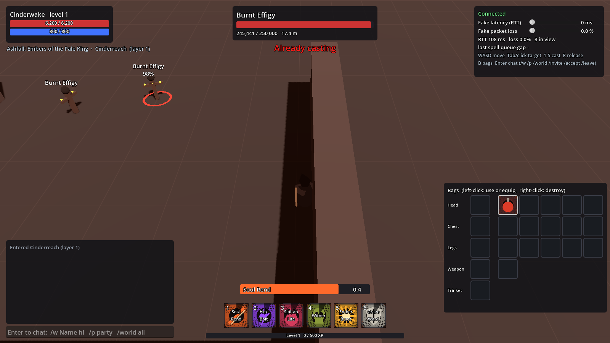

# Phase 3: a second game and a full zone

Done check (from the architecture doc): two tenants run on one engine build,
and one zone holds 1,000 bots with tick p99 under 20 ms.

**Both parts passed.**

| Check | Result |
|---|---|
| Second tenant from data plus an asset pack only | Ashfall runs next to Elderwood Online on the same binaries; no engine code mentions it |
| Layering under a crowd | 3 layers opened for 130 bots at a cap of 50, merged back to 1 when the crowd left; 30/30 stayed connected through 5 handoffs |
| 1,000 bots in one zone | tick p99 18.8 ms in the worst 10 s window, about 15 ms steady; 8.7 KB/s down per client; 1000/1000 stayed connected |



## The second tenant: Ashfall

`tenants/ashfall/` is a dark fantasy game: one class (the Grave Warden, six
abilities), eight mobs up to the Pale King, two zones (Cinderreach and the Pale
Vault, joined by a portal), its own items, XP curve, bag size, starting items
and UI colours. It is YAML plus `assets/`, nothing else.

* `packc tenants/ashfall -o build/ashfall.pack` compiles and validates it, the
  same way as the default tenant.
* `scripts/build-assets.sh ashfall` zips `assets/tenant/**` (8 models as
  `.tscn`, 18 icons, `theme.json`) into `build/ashfall-assets.zip`.
* `scripts/run-stack.sh ashfall 8000 6000` starts login, world and zones for it
  beside the Elderwood stack. Each tenant has its own Postgres database and
  Redis key prefix.
* The client downloads the content pack and the asset pack from the login
  service when their hashes change, mounts the assets at `res://tenant/`, and
  swaps models, ability icons and UI colours. A mob or class whose model is
  missing falls back to the built-in placeholder, so a half-finished asset pack
  still plays.

The placeholder models and icons are generated by
`tenants/ashfall/assets/make_assets.py`; the generated files are committed. Real
art from Blender replaces them file for file: export glTF, save it as a scene
under the same name, rebuild the zip.

## Layering

`scripts/layering-test.sh` runs against a stack started with `LAYER_CAP=50`.
A crowd of 100 short-lived bots and 30 long-lived ones log in through the real
login and world services ([timeline](load-tests/phase3-layering-timeline.txt)):

```
t+11s  elderwood#1=50  elderwood#2=50  elderwood#3=30
t+46s  elderwood#1=25  elderwood#2=5   elderwood#3=0        (crowd leaving)
t+51s  ...             elderwood#3=0 (draining)
t+61s  elderwood#1=25  elderwood#2=5 (draining)
t+66s  elderwood#1=30                                      (merged, layers 2 and 3 closed)
```

All 30 remaining bots stayed connected and were handed off 5 times in total.
These runs go through login, so the bots spread over layers the swarm cannot
see metrics for; their tick lines read "SKIP (no zone metrics)".

## 1,000 bots in one zone

```sh
./target/release/zone-server --zone elderwood:5600 --metrics 9400
nice -n 10 ./target/release/swarm --server 127.0.0.1:5600 --metrics 127.0.0.1:9400 \
  --bots 1000 --ramp-per-sec 100 --settle 12 --seconds 60 --threads 3 --max-tick-p99 20
```

Every bot roams a 120 m circle around the spawn and fights mobs, so every
player sees about 79 others (the view cap is 80). Full output:
[phase3-1000-bots.txt](load-tests/phase3-1000-bots.txt).

**The test machine is a 4-vCPU cloud VM, and the 1,000 bots run on it too.**
The bots use well over a core, and the server's net thread uses most of
another. How much CPU the bots leave the server decides the result:

| Run | Worst p99 window | Steady p99 | Verdict |
|---|---|---|---|
| Server on all 4 cores, bots at lower priority (the saved run) | 18.8 ms | about 15 ms | pass |
| Same, bots at normal priority | 24.1 ms | 15 to 19 ms | fail |
| Server pinned to 2 cores, bots on the other 2 | 24.4 ms | 20 to 22 ms | fail |

So a 1,000-player zone wants about 4 dedicated cores. With the bots on another
machine there would be more headroom; the snapshot benchmark below suggests
around 5 ms p99 for the snapshot step on 4 idle cores.

What it took:

* **Snapshots are the whole cost.** Input and AI are under 0.3 ms per tick. The
  snapshot step (choose the 80 nearest per player, delta-encode against what
  they acknowledged) is everything else, built in parallel with rayon.
* Positions are stored next to the index in each grid cell, so the nearest-80
  scan walks small arrays instead of entity states.
* Entities are numbered in id order, so sorting a player's view is a sort of
  small integers rather than of whole entity states.
* The zone server uses mimalloc: every client allocates per tick on several
  threads at once, and the system allocator contended under it (live snapshot
  time fell by about a third).

`cargo test --release -p zone-server snapshot_cost -- --ignored --nocapture`
benchmarks the snapshot step alone for 1,000 players: p50 3.0 ms on 4 threads,
9.1 ms on 1.

## Not done yet

* The 1,000-bot test should be rerun with the bots on a second machine before
  choosing production hardware.
* The Ashfall art is generated placeholders; the asset pipeline is what is real.
* Combat-feel numbers are still unchanged from Phase 0, waiting on Hung's
  hands-on test.
